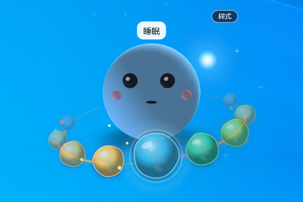
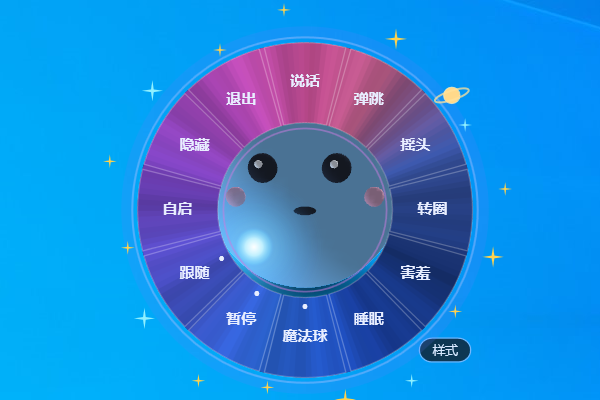

# 豆仔 · 3D 桌面宠物

一只住在你桌面右下角的蓝色小球。纯 WPF 3D、**单文件源码**、**零第三方依赖、零素材文件**——
所有形状都是代码里用 `Sphere()` 现搓的，所有图标都是运行时画的，连托盘图标都不需要 png。



## 它现在会做什么

**看得见的部分**
- 3D 球体 + 会跟着鼠标转的瞳孔（鼠标靠近时眼睛会放大）
- 呼吸浮动、走路时上下小跳、侧身走路只转 35°（转满 90° 五官会被轮廓切掉）
- 落地 / 撞墙时有果冻式压扁回弹（欠阻尼弹簧驱动，不是贴图动画）
- 影子随离地高度收缩变淡
- 六种情绪：`happy` `shy` `curious` `sleepy` `doze` `neutral`（影响眼睛开合、腮红、浮动节奏）
- 打盹时闭眼、嘴角挂一颗水珠、每隔几秒冒 Zzz
- 三句固定台词：开机「豆仔来啦～」、睡着「豆仔困啦」、醒来「豆仔醒啦」
- 说话时气泡 + 嘴巴一张一合

**玩得动的部分**
- **拖起来像拎起一颗软糖**：拖动时窗口跟手，松手有自由落体
- **甩出去变弹珠**：快速甩到屏幕边界会脱手，按反弹速度在四壁之间来回弹，撞墙时压扁一下，摩擦减速到停
- **魔法球小伙伴**：桌面上飘着一颗青白色光球（独立小窗、鼠标穿透、始终浮在豆仔之上）。豆仔走路时球跟在它身后贴地一跳一跳（像大人带小孩），待机时球沿椭圆轨道在它身前身后绕圈；偶尔绕到脸前，豆仔扑一下扑空，球喷出一圈小星点、豆仔开心两秒。右键「魔法球（小伙伴）」可开关
- 单击 → 转正面向你；双击 → 跳一下；连点 → 各种动作
- 5 分钟没人理 → 自己睡着；碰它一下就醒
- **AI 聊天窗（可选）**：右键「说话」打开聊天窗，接任意 **OpenAI 兼容接口**（DeepSeek / 豆包方舟 / Ollama / 中转站都行），对话显示在窗口里、豆仔把回复念出来；没配接口时自动退回"让豆仔说话"

**自动化的部分**
- **右键「星体轨道」菜单（新默认）**：12 颗半透明**水彩星体**顺着一条倾斜的椭圆轨道绕着豆仔转——说话、弹跳、摇头、转圈、害羞、睡眠/唤醒、魔法球、暂停、跟随、自启、隐藏、退出。**每颗星体一个颜色**（珊瑚/琥珀/柠檬/青柠/翡翠/天蓝/靛蓝/紫罗兰/紫红/玫瑰/橙/青绿），颜色本身就是识别标记；轨道是一条**水彩彩带**，周围还散着几粒颜料飞溅点。**滚轮**或**按住右键左右拖动**转动轨道，选中的那颗转到正前方（最大最亮，带一圈同色光环）；轨道的**后半圈从豆仔眼睛后面穿过**，转到背面的星体会被豆仔挡住、同时透明度更低。界面上不写文字，选中项的名字由**豆仔用说话气泡念出来**；**已经开启的开关项（魔法球/暂停/跟随/自启）星体会变成暖金色**。松手即执行当前那颗；不拖只点一下则菜单保持展开，之后左键执行、滚轮继续转。右上角「样式」按钮（星体轨道模式下会挪到右上角空区）点一下循环切换六套皮肤：**星体轨道**（默认）、金色法阵、星空、霓虹、彩色扇区、星云（旧五套作为遗留保留，仍是原来的环形扇区交互）；选过哪套会被记住，重启后还是那套（记在 `%APPDATA%\DouzaiDesktopPet\config.ini`，删掉就回默认）
- 托盘图标 + 托盘菜单（同一套功能）

旧皮肤里最花的一套——星云（蓝紫玫红的环带 + 金色星芒 + 带环小行星，环上颜色缓慢自转）：



- 单实例：重复启动只会冒一句「我已经在这儿啦」然后自杀
- 边界吸附、多显示器工作区适配、125% DPI 下实测通过
- 本地 HTTP API + MCP（同一端口，JSON-RPC 自动识别），外部程序/AI 可以直接操控它

## 快速开始

需要：Windows 10/11 + .NET Framework 4.x（系统自带，不用装）。

**方式一**：双击 `run.cmd`

**方式二**：
```powershell
powershell -NoProfile -ExecutionPolicy Bypass -File .\build-run.ps1
```

两种方式等价：调用系统自带 `csc.exe` 编译 `pet.cs`，产出 `DesktopPet.exe` 并启动。
Windows PowerShell 5.1 和 PowerShell 7+ 都能跑。

手动编译（想自己控制参数时）：
```powershell
$csc = "$env:WINDIR\Microsoft.NET\Framework64\v4.0.30319\csc.exe"
# 引用 WPF 程序集，参考 build-run.ps1 里的查找逻辑
& $csc /nologo /target:winexe /optimize+ /out:DesktopPet.exe @refs .\pet.cs
```

## 用法

| 操作 | 效果 |
| --- | --- |
| 单击 | 转正面向镜头，1.5 秒内不乱走（睡着时会醒） |
| 双击 | 原地跳一下 |
| 按住拖动 | 拎起来走；松手按原有高度做自由落体 |
| 快速甩到边界 | 脱手变成弹珠，撞墙反弹、来回弹到停 |
| 右键 | 打开「星体轨道」菜单：滚轮或按住右键左右拖切换，松手执行当前那颗 |
| 左键（菜单展开时） | 执行当前选中的星体（离开轨道范围则关闭菜单）|

旧的五套环形菜单还留着（样式按钮能切回去），用法不太一样：

- 菜单是一个贴着豆仔弹出来的 12 格圆环（每格 30°，中心圆洞露出它的脸）。按住右键拖到某格松手即执行；只点一下不拖则保持展开，之后左键点格执行，点中心或圈外取消。
- 右下角「样式」胶囊点一下逐套换过去，顺序是：星体轨道 → 彩色扇区 → 金色法阵 → 星空 → 霓虹 → 星云 → 回到星体轨道；在星体轨道模式下这个胶囊挪到右上角空区。切哪套都会立即写进 `config.ini`。
- 环形菜单上有一道光顺时针流过整圈，约 3.6 秒一圈，鼠标停在轮盘上会加速一倍；金色法阵和星云不掺这道流动色，保持各自的干净。
- 星云是环带用 180 片 2° 细扇区拼出来的角度渐变（深蓝→宝蓝→靛→紫→品红→玫红），外面一圈金色星芒加一颗带环小行星，整圈约 43 秒自转一圈；12 个标签压在环带之上，不会被彩环糊掉。

右键菜单里「暂停闲逛」勾上之后它就待在原地不动（移动、动作类 API 不受影响）。

## AI 聊天（可选）

「说话」打开的是聊天窗，可以接任意 **OpenAI 兼容** 的 `/chat/completions` 接口。

配置：聊天窗右上角「设置」（或 Ctrl+O）填：

| 字段 | 说明 |
| --- | --- |
| 接口地址 | base URL，例 `https://api.deepseek.com/v1`、`https://ark.cn-beijing.volces.com/api/v3`、`http://127.0.0.1:11434/v1` |
| API Key | 按需填；本地 Ollama 可以留空 |
| 模型名 | 例 `deepseek-chat`、豆包推理接入点 `ep-xxxxxxxx`、`qwen2.5` |
| 人设提示词 | 可选，默认是一只圆滚滚蓝色小球的可爱人设 |

- 配置写在 `%APPDATA%\DouzaiDesktopPet\config.ini`（`ai_url` / `ai_key` / `ai_model` / `ai_prompt`）。**Key 是本机明文**，别把这份配置外发。
- 回复完整显示在聊天窗；豆仔头顶气泡只念前 60 个字，等待时先说「豆仔想想…」。
- 窗口是深空渐变 + 水彩光斑的样式：豆仔头像气泡、你右侧的紫蓝渐变气泡、输入框聚焦高亮、胶囊按钮、「豆仔正在想 ···」等待提示。
- **无边框自绘标题栏**（不再有系统白条）：拖标题区移动窗口、边缘可缩放、右上角是最小化/关闭；设置面板用同一套标题栏和深色主题。
- **窗口位置/大小会记住**：关掉再打开回到上次的位置和尺寸（超出屏幕会自动收回来），第一次打开才居中。
- **窗口配色可切换**：标题栏左边的彩色圆点，点一下换一套配色（深空 / 暮光 / 深海 / 暖沙 / 墨黑 / 乳白 / 纯白），换完立刻生效并自动保存。
- 窗口底色和消息面板同色，四角不会有"透亮"的边（边框是一条半透明深色细线，像阴影）。
- 输入框获得焦点时只是**淡强调色描边**（和发送按钮不同色），发送按钮和边框之间留了间距，不会有"按钮颜色溢出"的感觉。
- 窗口状态存在 `config.ini`：`chat_theme`（配色序号）、`chat_left` / `chat_top` / `chat_w` / `chat_h`（位置大小）。
- 只做非流式、超时 30 秒；未配置或连不上都会在窗口里提示，不会崩。
- 用 .NET 自带 HTTP 实现，没引入第三方库，仍然一条 `csc.exe` 命令编译。

## 和豆仔说话做动作

聊天窗里直接说这些，豆仔会立刻做动作（本地执行，不调用模型、不花 token）：

| 说 | 动作 |
| --- | --- |
| 跳一下 / 蹦蹦 | 弹跳一下 |
| 摇摇头 | 左右摇头 |
| 转个圈 / 转一圈 | 原地转 360° |
| 害羞 / 开心 / 好奇 / 困了 | 换表情情绪 |
| 睡觉 / 醒来 | 睡觉或者叫醒 |
| 魔法球 | 开关魔法球 |
| 跟随 / 暂停 / 继续 | 跟着鼠标 / 停住 / 恢复 |
| 换个造型 | 菜单皮肤在 6 套里轮换 |
| 换个配色 / 换个主题 | 聊天窗配色在 7 套里轮换 |
| 隐藏 / 显示 | 藏起来 / 出来 |
| 说：你好呀 | 把冒号后面的话念出来 |
| 帮助 / 你会什么 | 在聊天窗里列出全部指令 |

其它内容会正常发给配置的 AI 模型回答；动作指令即使没配接口也能用。

## 本地 API

默认端口 `8787`，被占用会自动 +1 到 8789。只监听 `127.0.0.1`。
响应统一格式：`{"code":0,"msg":"ok","data":{...}}`。

```powershell
Invoke-RestMethod http://127.0.0.1:8787/status
```

| 方法 | 路径 | 说明 / 参数 |
| --- | --- | --- |
| GET | `/` | 接口自述 |
| GET | `/status` | `state`（idle/walk/doze）、`x`、`y`、`port`、`visible`、`mood` |
| GET | `/pet/port` | 当前实际端口 |
| POST | `/pet/chat` | `{"text":"..."}` 弹气泡 3 秒 |
| POST | `/pet/action` | `{"action":"idle\|bounce\|jump\|shake\|turn\|blush"}` |
| POST | `/pet/visible` | `{"show":true\|false}` |
| POST | `/pet/move` | `{"x":789,"y":470}` 单位 DIP，平滑移动，自动钳制在屏幕内 |
| POST | `/pet/mood` | `{"mood":"happy\|shy\|curious\|sleepy\|doze\|neutral"}`，非法值返回 `code:1` |
| POST | `/pet/pause` | `{"on":true\|false}` 暂停/恢复自动闲逛 |
| POST | `/pet/face` | 转正面向镜头 |
| POST | `/jump`、`/walk?dir=1&seconds=5`、`/idle` | 早期接口，保留兼容 |

> 注意：任何一次调用都会把它唤醒（这是设计如此），所以脚本查状态也会触发「豆仔醒啦」。

## MCP

同一端口上，请求体含 `"jsonrpc"` 就走 MCP（protocol `2024-11-05`，server 名 `desktop-pet`）。
共 8 个工具：`pet_chat`、`pet_action`、`pet_visible`、`pet_move`、`pet_mood`、`pet_pause`、`pet_face`、`pet_status`。

## 想改手感？这些都是常量

都集中在 `pet.cs` 顶部，改完重编译即可。

| 常量 | 默认 | 作用 |
| --- | --- | --- |
| `DefaultPort` | 8787 | 本地 API 起始端口 |
| `DozeAfterSeconds` | 300 | 多久无交互自动睡着 |
| `WalkYawDeg` | 35 | 走路侧身角度（调大五官会被轮廓切掉） |
| `BlinkCycle` / `BlinkLen` | — | 眨眼周期与眨眼时长 |
| `BallLaunchSpeed` | 200 | 撞边界超过这个速度才脱手 |
| `BallThrowSpeed` | 350 | 松手甩出去的阈值 |
| `BallMaxSpeed` | 1600 | 初速上限，防止甩成光速 |
| `BallWallDamp` | 0.80 | 撞墙保留的速度比例 |
| `BallFriction` | 700 | 飞行时每秒减速（DIP/s²） |
| `BallStopSpeed` | 55 | 低于这个速度停下 |
| `OrbRx` / `OrbRy` | 150 / 52 | 星体轨道长/短半径（DIP），短半径越小轨道越扁、越贴脸 |
| `OrbTilt` | -0.14 | 轨道整体旋转角（弧度） |
| `OrbOffY` | 44 | 轨道中心整体下移量，决定后半圈从豆仔眼睛后面多高的位置穿过 |
| `OrbStepDeg` | 30 | 相邻两颗星体的角度间隔 |
| `BallVisR` / `BallOffY` | 78 / -15 | 豆仔球体的视觉半径与球心偏移，决定「转到背面被挡住」的判定 |

## 已知取舍（不是 bug，是做过取舍）

- **星体轨道菜单故意没有底板**：弹窗里只画星体和轨道线，其余透明——这样豆仔的说话气泡（画在宠物窗口里、在弹窗下面）才能露出来。代价是深色/花哨壁纸上星体的对比度要靠自己的亮边和软影，略逊于带深色底板的环形菜单。
- **水彩是"叠加"出来的**：每颗星体是一层水彩渐变 + 一层相邻色叠色 + 一圈化开的颜料晕 + 手绘感的正弦描边，没有贴图；高光/反光特意压得很淡（0x8E / 0.26 不透明度），要的是水彩的哑光感而不是玻璃球。
- **背面星体几乎看不见是有意的**：轨道后半圈压得很扁、透明度最低只有 4%，且大部分落在豆仔轮廓里被挡住——这就把十二颗星体在 360° 环上的排布"藏"成了只看到前面几颗，纵深感强，但也就看不出总数（想数全得靠转）。
- **滚轮要宠物窗口有焦点**：右键点过豆仔后窗口会激活，滚轮才收得到；没焦点时用「按住右键左右拖动」一样能转。
- **星体的纵深是假透视**：没有真的 3D 轨道渲染，是靠「椭圆轨道 + 近大远小 + 转到球后面被遮挡」三件事拼出来的，所以轨道角度是写死的常数。

- **果冻形变的球底下沉 9~10px**：压扁时下半球逐顶点下压，视觉上球底会略低于地面。对比过「真软体物理」，那套在这个尺寸下太贵、容易抖，选了这套解析近似。
- **球体是 24×32 分段**：正常大小看不见棱，放大 4 倍能看到多边形折线。升到 48 段会让每帧顶点重算翻几倍，暂时不值。
- **贴白色窗口时边缘会发亮**：WPF 分层窗口 + 抗锯齿 + 白色背景混合的必然结果，不是配色问题。
- **单文件是有意为之**：全部逻辑在一个 `pet.cs` 里，方便看懂全貌、方便一条命令编译。代价是多人同时改冲突集中。

## 目录结构

```
pet.cs                     全部源码（几何、动画、菜单、聊天窗、托盘、HTTP/MCP 服务）
build-run.ps1              一键编译 + 启动（PS 5.1 / 7 通用）
run.cmd                    双击即跑
tests/test-api.ps1         REST 冒烟测试
tests/test-mcp.ps1         MCP 冒烟测试
openapi.yaml               REST 接口的 OpenAPI 描述（14 个路径，给外部工具/AI 看）
POSE-API.md                姿态接口说明
screenshots/               README 用图
```

运行时产物不进仓库：`DesktopPet.exe`、`pet.log`（>2 MB 自动清空）在 `.gitignore` 里；配置在 `%APPDATA%\DouzaiDesktopPet\config.ini`。

## 参与贡献

欢迎 PR。为了不让这个项目变成难维护的大杂烩，几条约定：

1. **增量改，别重排整段**。`pet.cs` 是单文件，大面积格式化会制造无意义冲突。
2. **保持一条 csc 命令能编译**。不引入 NuGet 包、不引入图片/字体素材、不拆文件。
3. **接口零破坏**。已有 REST 路径、参数、`{"code":0,...}` 响应格式尽量不动；要加就加字段、加端点。
4. **异常必须吞掉并写 `pet.log`**。这个程序不该因为一次动画失败就挂掉。
5. **改动请自己验证**：跑一遍 `tests/test-api.ps1`，并说明你实际观察到的现象（截图更好）。

## License

MIT，见 [LICENSE](LICENSE)。
