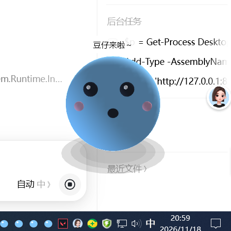

# 豆仔 · 3D 桌面宠物

一只住在你桌面右下角的蓝色小球。纯 WPF 3D、**单文件源码**、**零第三方依赖、零素材文件**——
所有形状都是代码里用 `Sphere()` 现搓的，所有图标都是运行时画的，连托盘图标都不需要 png。



## 它现在会做什么

**看得见的部分**
- 3D 球体 + 会跟着鼠标转的瞳孔（鼠标靠近时眼睛会放大）
- 呼吸浮动、走路时上下小跳、侧身走路只转 35°（转满 90° 五官会被轮廓切掉）
- 落地 / 撞墙时有果冻式压扁回弹（欠阻尼弹簧驱动，不是贴图动画）
- 影子随离地高度收缩变淡
- 六种情绪：`happy` `shy` `curious` `sleepy` `doze` `neutral`（影响眼睛开合、腮红、浮动节奏）
- 打盹时闭眼、嘴角挂一颗水珠、每隔几秒冒 Zzz
- 三句固定台词：开机「豆仔来啦～」、睡着「豆仔困啦」、醒来「豆仔醒啦」
- 说话时气泡 + 嘴巴一张一合

**玩得动的部分**
- **拖起来像拎起一颗软糖**：拖动时窗口跟手，松手有自由落体
- **甩出去变弹珠**：快速甩到屏幕边界会脱手，按反弹速度在四壁之间来回弹，撞墙时压扁一下，摩擦减速到停
- 单击 → 转正面向你；双击 → 跳一下；连点 → 各种动作
- 5 分钟没人理 → 自己睡着；碰它一下就醒

**自动化的部分**
- 右键菜单：动作（待机/弹跳/摇头/转圈/害羞）、情绪、睡眠、跟着鼠标、暂停闲逛、开机自启、退出
- 托盘图标 + 托盘菜单（同一套功能）
- 单实例：重复启动只会冒一句「我已经在这儿啦」然后自杀
- 边界吸附、多显示器工作区适配、125% DPI 下实测通过
- 本地 HTTP API + MCP（同一端口，JSON-RPC 自动识别），外部程序/AI 可以直接操控它

## 快速开始

需要：Windows 10/11 + .NET Framework 4.x（系统自带，不用装）。

**方式一**：双击 `run.cmd`

**方式二**：
```powershell
powershell -NoProfile -ExecutionPolicy Bypass -File .\build-run.ps1
```

两种方式等价：调用系统自带 `csc.exe` 编译 `pet.cs`，产出 `DesktopPet.exe` 并启动。
Windows PowerShell 5.1 和 PowerShell 7+ 都能跑。

手动编译（想自己控制参数时）：
```powershell
$csc = "$env:WINDIR\Microsoft.NET\Framework64\v4.0.30319\csc.exe"
# 引用 WPF 程序集，参考 build-run.ps1 里的查找逻辑
& $csc /nologo /target:winexe /optimize+ /out:DesktopPet.exe @refs .\pet.cs
```

## 用法

| 操作 | 效果 |
| --- | --- |
| 单击 | 转正面向镜头，1.5 秒内不乱走（睡着时会醒） |
| 双击 | 原地跳一下 |
| 按住拖动 | 拎起来走；松手按原有高度做自由落体 |
| 快速甩到边界 | 脱手变成弹珠，撞墙反弹、来回弹到停 |
| 右键 | 打开功能菜单 |

右键菜单里「暂停闲逛」勾上之后它就待在原地不动（移动、动作类 API 不受影响）。

## 本地 API

默认端口 `8787`，被占用会自动 +1 到 8789。只监听 `127.0.0.1`。
响应统一格式：`{"code":0,"msg":"ok","data":{...}}`。

```powershell
Invoke-RestMethod http://127.0.0.1:8787/status
```

| 方法 | 路径 | 说明 / 参数 |
| --- | --- | --- |
| GET | `/` | 接口自述 |
| GET | `/status` | `state`（idle/walk/doze）、`x`、`y`、`port`、`visible`、`mood` |
| GET | `/pet/port` | 当前实际端口 |
| POST | `/pet/chat` | `{"text":"..."}` 弹气泡 3 秒 |
| POST | `/pet/action` | `{"action":"idle\|bounce\|jump\|shake\|turn\|blush"}` |
| POST | `/pet/visible` | `{"show":true\|false}` |
| POST | `/pet/move` | `{"x":789,"y":470}` 单位 DIP，平滑移动，自动钳制在屏幕内 |
| POST | `/pet/mood` | `{"mood":"happy\|shy\|curious\|sleepy\|doze\|neutral"}`，非法值返回 `code:1` |
| POST | `/pet/pause` | `{"on":true\|false}` 暂停/恢复自动闲逛 |
| POST | `/pet/face` | 转正面向镜头 |
| POST | `/jump`、`/walk?dir=1&seconds=5`、`/idle` | 早期接口，保留兼容 |

> 注意：任何一次调用都会把它唤醒（这是设计如此），所以脚本查状态也会触发「豆仔醒啦」。

## MCP

同一端口上，请求体含 `"jsonrpc"` 就走 MCP（protocol `2024-11-05`，server 名 `desktop-pet`）。
共 8 个工具：`pet_chat`、`pet_action`、`pet_visible`、`pet_move`、`pet_mood`、`pet_pause`、`pet_face`、`pet_status`。

## 想改手感？这些都是常量

都集中在 `pet.cs` 顶部，改完重编译即可。

| 常量 | 默认 | 作用 |
| --- | --- | --- |
| `DefaultPort` | 8787 | 本地 API 起始端口 |
| `DozeAfterSeconds` | 300 | 多久无交互自动睡着 |
| `WalkYawDeg` | 35 | 走路侧身角度（调大五官会被轮廓切掉） |
| `BlinkCycle` / `BlinkLen` | — | 眨眼周期与眨眼时长 |
| `BallLaunchSpeed` | 200 | 撞边界超过这个速度才脱手 |
| `BallThrowSpeed` | 350 | 松手甩出去的阈值 |
| `BallMaxSpeed` | 1600 | 初速上限，防止甩成光速 |
| `BallWallDamp` | 0.80 | 撞墙保留的速度比例 |
| `BallFriction` | 700 | 飞行时每秒减速（DIP/s²） |
| `BallStopSpeed` | 55 | 低于这个速度停下 |

## 已知取舍（不是 bug，是做过取舍）

- **果冻形变的球底下沉 9~10px**：压扁时下半球逐顶点下压，视觉上球底会略低于地面。对比过「真软体物理」，那套在这个尺寸下太贵、容易抖，选了这套解析近似。
- **球体是 24×32 分段**：正常大小看不见棱，放大 4 倍能看到多边形折线。升到 48 段会让每帧顶点重算翻几倍，暂时不值。
- **贴白色窗口时边缘会发亮**：WPF 分层窗口 + 抗锯齿 + 白色背景混合的必然结果，不是配色问题。
- **单文件是有意为之**：全部逻辑在一个 `pet.cs` 里，方便看懂全貌、方便一条命令编译。代价是多人同时改冲突集中。

## 目录结构

```
pet.cs                     全部源码（几何、动画、菜单、托盘、HTTP/MCP 服务）
build-run.ps1              一键编译 + 启动（PS 5.1 / 7 通用）
run.cmd                    双击即跑
tests/test-api.ps1         REST 冒烟测试
tests/test-mcp.ps1         MCP 冒烟测试
screenshots/               README 用图
```

## 参与贡献

欢迎 PR。为了不让这个项目变成难维护的大杂烩，几条约定：

1. **增量改，别重排整段**。`pet.cs` 是单文件，大面积格式化会制造无意义冲突。
2. **保持一条 csc 命令能编译**。不引入 NuGet 包、不引入图片/字体素材、不拆文件。
3. **接口零破坏**。已有 REST 路径、参数、`{"code":0,...}` 响应格式尽量不动；要加就加字段、加端点。
4. **异常必须吞掉并写 `pet.log`**。这个程序不该因为一次动画失败就挂掉。
5. **改动请自己验证**：跑一遍 `tests/test-api.ps1`，并说明你实际观察到的现象（截图更好）。

## License

MIT，见 [LICENSE](LICENSE)。
